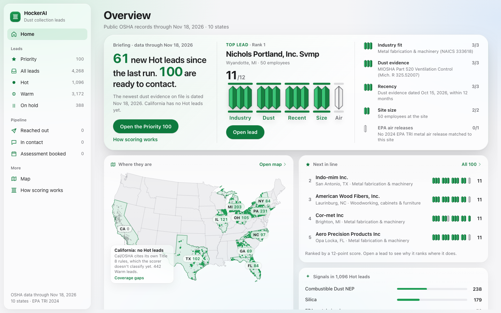
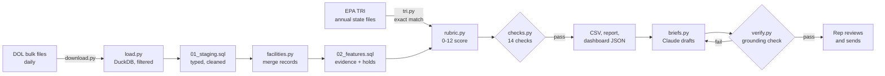

# HockerAI: dust-collection sales leads from OSHA and EPA records

A Python and SQL pipeline that turns public OSHA inspection data and EPA TRI metal air-release reports into a ranked list of manufacturers that may need industrial dust collection, with an optional step that drafts a lead brief and an email for a sales rep.

Built for Hocker North America, a dust-collection company in Stuart, Florida, which has used it to review sales leads.

**[Live dashboard](https://dipzinski.github.io/HockerAI/)** · [Lead report](outputs/report.md) · [Lead list (CSV)](outputs/leads.csv)



## The problem

Sales teams for industrial equipment aren't short of prospects: every plant that sands, grinds, cuts, or mixes powder is one. Their bottleneck is research time per lead: finding which plants have a reason to buy *now*, and what to say to them. OSHA publishes every inspection and citation, and a plant that was just cited for silica, poor ventilation, or combustible dust has a deadline to fix it. This project finds those plants and explains why each one is worth a call.

## Current scope

The search covers the ten most populous states using the Census Bureau's [Vintage 2025 estimates](https://www.census.gov/data/tables/time-series/demo/popest/2020s-state-total.html), ordered by population: CA, TX, FL, NY, PA, IL, OH, GA, NC, and MI. The latest EPA TRI Basic Data currently available to this pipeline is reporting year 2024.

## Results (records through 2026-11-18)

| | |
|---|---|
| OSHA inspections scanned | 5,212,725 nationwide |
| Kept: target industries in the ten states since 2019 | 32,675 inspections, 75,213 citations |
| Facilities after merging duplicate records | 22,447 (1,716 had 2+ spellings of their name) |
| **Hot leads (8-12 of 12)** | **1,096**: 1,046 ready for outreach, 50 held for human review |
| Warm leads (5-7) | 3,171 |
| Facilities with the EPA TRI point | 445 (964 TRI forms matched exactly; 3,229 target-industry forms unmatched) |
| Data-quality checks | 14 of 14 pass on every build |
| Unit tests | 58 pass |

Hot leads by state: PA 231, MI 203, IL 121, OH 105, TX 102, NC 97, FL 84, NY 84, GA 69, CA 0 (see Limitations). By industry: metal fabrication and machinery 559, woodworking and furniture 232, cement and minerals 156, food and grain 85, plastics 38, foundries 25, pharma 1. Each run writes the full breakdown to [outputs/report.md](outputs/report.md).

## How it works



1. **Download** (`hocker/download.py`): the five OSHA tables (inspections, citations, emphasis programs, accidents, injuries) from the Department of Labor, Census ZIP centroids for the map, and EPA TRI state CSVs. OSHA files are skipped when unchanged; the year-versioned TRI files are cached.
2. **Load** (`hocker/load.py`): unzips OSHA CSV chunks and reads them with DuckDB in one pass, keeping only target-industry inspections in the ten states since 2019.
3. **Stage** (`sql/01_staging.sql`): explicit types, withdrawn citations dropped, public agencies dropped, and impossible headcounts cleared (see Data quality).
4. **Merge facilities** (`hocker/facilities.py`): OSHA has no facility ID, so "SAUDER WOODWORKING CO" and "Sauder Woodworking Company" look like two plants. Records are merged only when state and ZIP agree and either the normalized name or a normalized street address plus a similar name matches (so two tenants of one building stay separate). Records missing state or ZIP are not name-merged and are flagged for facility-match review in the lead outputs.
5. **Classify citations** (`hocker/standards.py`): 4,371 distinct citation codes are parsed into readable form (`19100094 A01 I` → `29 CFR 1910.94(a)(1)(i)`) and sorted into dust-specific, dust-related, or other. Michigan runs its own OSHA program and cites Michigan rules (`R 325.52001`, Part 520 Ventilation Control), which are mapped with the same categories from the MIOSHA part index.
6. **Score** (`sql/02_features.sql`, `hocker/rubric.py`): adds one point for a positive reported TRI metal air release when facility name, ZIP, and state match one OSHA facility exactly after normalization.
7. **Check and export** (`hocker/checks.py`, `hocker/export.py`): the build stops if any check fails; otherwise it writes the CSV, the report, a list of new Hot leads since the last run, and the dashboard data. Brief verification checks source IDs, numbers, counts, format, and prohibited topics; it does not establish semantic support for process, upgrade, intent, or timing claims. Briefs remain drafts for human review and sending.

## How leads are scored

The 0-12 rubric carries forward the tested OSHA factors and adds one external-data point:

| Criterion | Points | Source |
|---|---|---|
| Industry fit | 0-3 | NAICS code, in the sales team's priority order: woodworking and metal fabrication 3; cement/minerals and food 2; pharma, plastics, foundries 1 |
| Dust evidence | 0-3 | 3: a dust-specific citation (silica, ventilation, air-contaminant limits, lead/chromium/cadmium/beryllium, grain handling, or a general-duty or hazard-communication citation in a Combustible Dust inspection). 2: a dust-related citation (housekeeping, respirators, spray booths, welding ventilation) or an inspection under a dust emphasis program. 1: any other serious citation |
| Recency | 0-3 | Newest dust evidence within 12, 24, or 36 months. A fresh citation comes with an abatement deadline, which is when a plant buys equipment. Unrelated citations earn no recency points, so a plant can't reach Hot without dust evidence |
| Site size | 0-2 | Employees at the inspected site (not company-wide): 20-500 earns 2, 10-19 or 501-1,000 earns 1 |
| TRI metal air release | 0-1 | One point when a Form R reports a positive fugitive or stack air release for a metal/metal compound in EPA TRI 2024 and matches one OSHA facility by normalized name, five-digit ZIP, and state |

**Hot** is 8-12, **Warm** 5-7, **Archive** 0-4. Every Hot lead still needs OSHA dust-related evidence; TRI alone cannot create a Hot lead, and a lead with only unrelated serious citations tops out at Warm. A TRI report is a facility-reported chemical release, not evidence of a violation or proof that a dust collector is needed. EPA reporting is limited to covered chemicals and facilities, and the 2024 release data is lagged. Name matching is deliberately conservative; unmatched and ambiguous records do not affect scores.

**Holds override the score** (v1's "Archive overrides score" rule): a fatality in the last 36 months, a serious-injury inspection in the last 24 months, or any loaded unresolved citation under contest blocks outreach until a person reviews the lead. The contest hold is independent of the 36-month scoring-evidence window; contested citations are not positive sales signals or talking points. **Confidence** is High when the site headcount is known and the industry code is consistent across inspections; a lead with Low confidence isn't outreach-ready.

## Lead-ranking improvement controls

HockerAI now keeps a score snapshot and a basic outcome-evaluation helper alongside the current rubric so a ranking change is tested before it becomes a new policy. The project writes a versioned `outputs/state.json` and `outputs/score_snapshots.json` that keep the latest 12 runs; re-running the same data date replaces that run. Each snapshot has a UTC run timestamp distinct from its `as_of` source date. `score_snapshots.json` is about 12 MB a run, so it stays local instead of in the repo. The helper in `hocker/lead_eval.py` can calculate `precision@K`, `recall@K`, and `lift@K` from ranked leads and sales dispositions. Unknown outcomes are excluded from precision@K, and each report includes the labeled lead count and coverage at K; precision is unavailable when no top-K leads have known outcomes. These are operational controls that keep the scoring rubric honest without adding extra weighted variables before the baseline is proven.

## Additional lead signals considered

The order below weighs commercial relevance, facility-level specificity, public availability, and repeatable matching. None has been validated against Hocker's historical sales/conversion data yet; the first is implemented as a cautious ranking signal, not a buying recommendation.

1. **Reported metal air releases (implemented):** EPA's [Toxics Release Inventory (TRI)](https://www.epa.gov/toxics-release-inventory-tri-program/tri-toolbox) provides facility-level annual fugitive and stack releases. Metal and metal-compound air releases are relevant to air-control exposure, but TRI does not identify particle size or prove that a release is dust; it is incomplete by design and does not establish a compliance problem.
2. **Air permits and enforcement:** EPA [ECHO Air Facility Search](https://echo.epa.gov/tools/web-services/facility-search-air) exposes Clean Air Act permits, inspections, violations, and enforcement. It is a useful follow-up signal, but many records concern pollutants or equipment unrelated to dust collection.
3. **Facility expansion or capital projects:** state/local economic-development announcements, environmental permits, and construction records can indicate a near-term project budget. Coverage and formats vary by jurisdiction, so national facility matching and ongoing maintenance would be harder.
4. **Relevant hiring and workforce growth:** maintenance, EHS, process-engineering, and production vacancies can identify changing capacity or attention to air controls. Public job-posting access is fragmented, often licensed, and postings can be stale or duplicated.
5. **Local manufacturing market size:** Census [County Business Patterns](https://www.census.gov/programs-surveys/cbp/data/datasets.html) provides establishments, employment, and payroll by industry and geography. It can prioritize sales territories, but it is area-level and lagged rather than evidence about an individual plant's current need.

The next step to make these weights credible is to compare each signal with Hocker's actual lead dispositions, quotes, and sales outcomes, then calibrate weights using a time-based holdout rather than hand-tuning.

## AI lead briefs (Claude API)

`python -m hocker briefs` writes a brief for each of the top 25 outreach-ready Hot leads:

- **Input:** only that facility's records as JSON: the dust-related citations in full and a count of unrelated ones. No web search, no personal names, and no injury details.
- **Output:** a fixed JSON schema enforced with structured outputs: `why_now`, `talking_points` (each citing the inspection IDs it came from), `suggested_contact_role`, `email_subject`, `email_body`.
- **Verification** (`hocker/verify.py`), in code rather than in the prompt: every inspection ID must exist in that facility's records; every number in the draft (penalties, dates, headcounts, standards) must appear in the records, so a computed total or a rounded figure fails; stated counts of citations or inspections must be correct; banned topics (injuries, lawsuits, compliance guarantees, prices) and dollar amounts in the email fail.
- **Retry:** a failing draft goes back to Claude once with the checker's list of problems; if it still fails, it's marked "needs human edit". Results, token use, and cost go to `outputs/briefs/summary.json`.
- **Tests:** `tests/test_verify.py` feeds the checker drafts with seeded errors (an invented penalty, a wrong inspection ID, a computed total, a wrong count, banned topics), and `tests/test_briefs.py` runs the retry loop against a fake client, so the logic is tested without API calls.

Model: `claude-opus-5-5` with structured JSON output; 25 briefs are estimated to cost $1-3.

## Data quality

Problems found in the source data and how the pipeline handles them:

- **Company-wide headcounts entered as site headcounts:** e.g. 150,000 employees at one meat plant. 97 values of 5,000 or more are cleared, which lowers that lead's confidence instead of inflating its size.
- **Duplicate facilities:** 24,560 distinct raw name/ZIP pairs collapse to 22,447 facilities; tests cover renamed companies at the same address and unrelated tenants of one building. The 52 inspections missing a ZIP or state are kept apart and flagged for review instead of being merged by name.
- **Withdrawn citations:** rows with `DELETE_FLAG = 'X'` are dropped, and a check confirms none survive.
- **Two citation systems:** federal codes and Michigan's MIOSHA rules are both classified; Michigan rule numbers are mapped by range because some prefixes are shared by unrelated parts (e.g. R 325.511xx covers both air contaminants and labor camps).
- **Mixed CSV quoting:** some chunks were auto-detected with no quote character, which broke on citation text with commas; quoting is set explicitly, and rejected rows are counted (0).
- **Lagging accident data:** the accident tables have almost no records after 2022, so holds also use the inspection type (fatality/catastrophe and accident inspections), which is current.

The 14 checks (`hocker/checks.py`) cover unique IDs, one facility per inspection, citations linked to inspections, no withdrawn citations, every standard classified, territory and industry filters, date window, headcount range, one score per facility, score arithmetic, tier cutoffs, holds never outreach-eligible, every Hot lead backed by dust evidence, and TRI points backed by a matched positive release.

## Run it

```bash
python3 -m venv .venv && source .venv/bin/activate
pip install -r requirements.txt
python -m hocker all            # download (~3.9 GB, skips unchanged files) + build (about a minute)
pytest                          # 58 tests
open docs/index.html            # or serve docs/ and open it in a browser
```

AI briefs (optional; needs an Anthropic API key):

```bash
export ANTHROPIC_API_KEY=...    # from console.anthropic.com
python -m hocker briefs         # top 25 outreach-ready Hot leads
python -m hocker briefs --dry-run   # writes the exact prompt inputs, no API calls
```

Rerunning `python -m hocker all` after the Department of Labor updates its files writes `outputs/new_hot_leads.md`, the Hot leads that are new since the previous data date.

## Project layout

```
hocker/           Python package: download, load, facilities, standards, tri, rubric, checks, export, briefs, verify
sql/              DuckDB SQL: staging and features
tests/            pytest: parsing, merging, scoring, verifier, retry loop
docs/             GitHub Pages dashboard (index.html + data/leads.json)
outputs/          leads.csv, report.md, run_log.json, briefs/
v1-prompt-prototype/   the July 2026 prototype (see below)
```

## Limitations

- OSHA inspects a small share of plants, so no citations doesn't mean no dust problem. The list finds plants with a documented, recent reason to buy; it can't see the rest.
- A citation is an allegation until it's final, and the dashboard says so.
- California shows 0 Hot leads. Cal/OSHA cites its own Title 8 rules (e.g. §5141, control of harmful exposures), and those codes aren't classified yet, so 15,067 of CA's 15,073 loaded citations count as "other" and none of its 4,327 facilities is Hot.
- Industry weights and the TRI point have not been validated against real sales outcomes.
- TRI matching requires an exact normalized name, state, and ZIP; it will miss legitimate facilities with different operating names and avoids scoring ambiguous matches.
- TRI reporting is limited to eligible chemicals and facilities, and the current 2024 file is not real-time.
- Map points sit at the ZIP code's center, not the street address.
- NAICS codes are entered by inspectors and are sometimes wrong; facilities whose code changes between inspections get lower confidence.

## v1 → v2

**v1 (July 2026)** was four Claude Code subagents defined in Markdown (lead generation, daily scan, enrichment and scoring, outreach drafting) with a shared scoring rubric and guardrails. It had no code: the model searched the web, scored leads, and wrote the CSV itself. A smoke test on 5 Ohio woodworking companies worked, but the scores couldn't be reproduced, the "daily scan" never ran, and the no-fabrication rules existed only as instructions to the model. v1 is kept in [`v1-prompt-prototype/`](v1-prompt-prototype/).

**v2 (September 2026)** keeps v1's idea, rubric, and guardrails and moves everything that can be deterministic into tested code: a public data source instead of open web search, SQL features, a rule-based score, automated checks, and a verifier that enforces the no-fabrication rules on the model's output. The model now does only what it's good at, writing the brief and email, and a person still approves every message.
